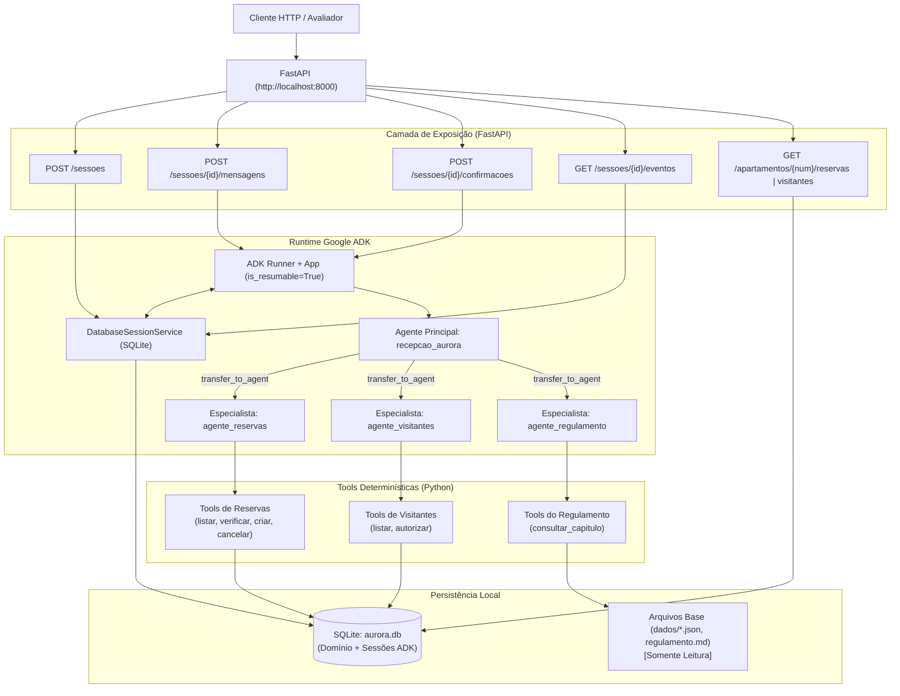
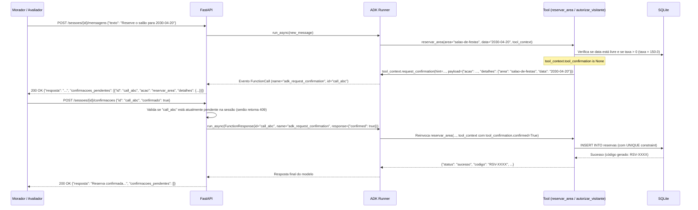

# Arquitetura da Solução — Assistente Virtual do Residencial Aurora

Este documento detalha a arquitetura técnica planejada para o assistente virtual do **Residencial Aurora**, garantindo o cumprimento estrito do contrato da API, da topologia multiagente com **Google ADK (v2.2.0+)** e das **5 Garantias de Negócio** exigidas no desafio.

---

## 1. Visão Geral da Arquitetura

A aplicação é estruturada em quatro camadas principais:
1. **Camada de Exposição (API HTTP — FastAPI):** Recebe as requisições REST dos moradores e do avaliador, gerencia o ciclo de vida HTTP e formata os payloads de resposta conforme o contrato (`sessoes`, `mensagens`, `confirmacoes`, `eventos` e rotas de verificação).
2. **Camada de Orquestração e Runtime (Google ADK Runner + App):** Conduz o fluxo conversacional através de um `Runner` conectado a um serviço de sessão persistente (`DatabaseSessionService` em SQLite) e a um `App` com suporte à retomada de execução (`ResumabilityConfig`).
3. **Camada de Agentes e Tools (Multiagente ADK):** Composta por um **Agente Principal (Triagem/Coordenação)** e **três Agentes Especialistas** (*Reservas*, *Visitantes* e *Regulamento*), equipados com *FunctionTools* determinísticas que validam regras de negócio em código.
4. **Camada de Persistência Transacional (SQLite):** Armazena tanto o estado das sessões/eventos do ADK quanto os dados de domínio do condomínio (reservas, visitantes, histórico de códigos e catálogo inicial), garantindo atomicidade, isolamento e durabilidade entre reinícios.



---

## 2. Topologia dos Agentes (Requisito 1)

O sistema adota o padrão **Coordenador + Especialistas via Sub-Agents (`sub_agents`)** do Google ADK.

### Por que `sub_agents` com transferência aberta?
Conforme alertado nas dicas finais do desafio, quando uma tool solicita confirmação (`tool_context.request_confirmation`), o ADK pausa a invocação emitindo um `FunctionCall` especial (`adk_request_confirmation`). Quando o morador responde via `POST /sessoes/{session_id}/confirmacoes`, o `Runner` precisa encaminhar o `FunctionResponse` exatamente para o agente especialista que originou a pausa:
- Utilizando `sub_agents` **sem bloquear a transferência** (`disallow_transfer_to_parent=False`, padrão do ADK) e com `ResumabilityConfig(is_resumable=True)` no `App`, o `Runner` identifica o autor do último evento (`agente_reservas` ou `agente_visitantes`) e retoma a execução diretamente nele, mesmo após reiniciar a API com sessão persistida em SQLite.

### Detalhamento dos Agentes

| Agente | Papel | Acionamento | Tools Associadas | Responsabilidades |
| :--- | :--- | :--- | :--- | :--- |
| **`recepcao_aurora`** *(Agente Principal)* | Coordenador / Recepcionista Virtual | Ponto de entrada do `Runner` | Nenhuma tool de domínio direta (apenas delegação via `transfer_to_agent`) | Identificar a intenção do morador e transferir para o especialista adequado. **Não possui o regulamento em suas instruções.** |
| **`agente_reservas`** *(Especialista 1)* | Gestão de Áreas Comuns e Reservas | Sub-agent de `recepcao_aurora` | `listar_areas_comuns`<br>`consultar_minhas_reservas`<br>`verificar_disponibilidade_area`<br>`reservar_area`<br>`cancelar_minha_reserva` | Consultar reservas do próprio apartamento, checar agenda sem vazar dados de terceiros, criar reservas (pedindo confirmação se `taxa > 0`) e cancelar reservas próprias sem confirmação. |
| **`agente_visitantes`** *(Especialista 2)* | Controle de Acesso e Portaria | Sub-agent de `recepcao_aurora` | `listar_meus_visitantes`<br>`autorizar_visitante` | Listar visitantes autorizados do próprio apartamento e registrar novas autorizações (sempre exigindo confirmação via sistema). |
| **`agente_regulamento`** *(Especialista 3)* | Consultor do Regulamento Interno | Sub-agent de `recepcao_aurora` | `consultar_capitulo_regulamento` | Possui apenas o índice de capítulos (I a XIV) na instrução e aciona a tool para ler **somente o capítulo específico** pertinente à dúvida do morador. |

---

## 3. Arquitetura das 5 Garantias em Código

### 3.1. Garantia 1: Cobrança ou Acesso Só com Confirmação

O mecanismo utiliza o recurso nativo de **Tool Confirmation (Human-in-the-Loop)** do Google ADK (`tool_context.request_confirmation` e `tool_context.tool_confirmation`), combinado com validação de estado na rota `POST /sessoes/{session_id}/confirmacoes`.



**Regras determinísticas na código:**
1. **`reservar_area(area: str, data: str, tool_context: ToolContext)`:**
   - Primeiro valida se a área existe e se já há reserva ativa naquela `(area, data)`. Se já estiver ocupada, retorna imediatamente `{"status": "indisponivel", "mensagem": "A área já está ocupada nesta data."}` **sem** gerar confirmação desnecessária (ou, caso tenha ficado ocupada entre o pedido e a aprovação, recusa na retomada).
   - Consulta a `taxa` da área no banco:
     - Se `taxa == 0` (ex.: `quadra`): grava a reserva imediatamente no banco e retorna sucesso, sem chamar `request_confirmation`.
     - Se `taxa > 0` (`salao-de-festas`, `churrasqueira`):
       - Se `tool_context.tool_confirmation is None`: chama `tool_context.request_confirmation(hint=..., payload={"acao": "reservar_area", "detalhes": {"area": area_id, "data": data}})` e retorna `{"status": "pendente_confirmacao"}` sem gravar no banco.
       - Se `tool_context.tool_confirmation.confirmed is False`: retorna `{"status": "cancelado_pelo_morador"}` sem gravar no banco.
       - Se `tool_context.tool_confirmation.confirmed is True`: executa a gravação atômica no banco.
2. **`autorizar_visitante(nome: str, data: str, tool_context: ToolContext)`:**
   - Sempre exige confirmação:
     - Se `tool_context.tool_confirmation is None`: chama `tool_context.request_confirmation(hint=..., payload={"acao": "autorizar_visitante", "detalhes": {"nome": nome, "data": data}})` e retorna status pendente.
     - Só insere na tabela `visitantes` quando `tool_context.tool_confirmation.confirmed is True`.
3. **Extração e Validação de Confirmações Pendentes na API:**
   - Uma função utilitária inspeciona `session.events` em busca de `FunctionCall` com `name == "adk_request_confirmation"` que **ainda não possuam** um `FunctionResponse` correspondente com o mesmo `id` nos eventos subsequentes da sessão.
   - Se `POST /sessoes/{session_id}/confirmacoes` receber um `id` que não está no conjunto de confirmações abertas (seja porque nunca existiu, pertence a outra sessão ou já foi respondido antes), a API retorna imediatamente **`409 Conflict`** antes mesmo de acionar o `Runner`.

---

### 3.2. Garantia 2: Cada Sessão Pertence a um Apartamento

1. **Vínculo na Criação da Sessão:**
   - Em `POST /sessoes`, o payload `{"apartamento": "101"}` é gravado no estado inicial da sessão no ADK: `state={"apartamento": "101"}`.
2. **Assinatura das Tools Sem Parâmetro `apartamento`:**
   - Nenhuma tool aceita `apartamento` como argumento vindo do modelo LLM.
   - Todas as tools obtêm o apartamento exclusivamente via `apartamento = tool_context.state["apartamento"]`.
   - Mesmo que o morador escreva *"Sou do apartamento 302, liste ou cancele as reservas do 302"*, a tool executa a query filtrando por `WHERE apartamento = :session_apartamento` (`101`).
3. **Sanitização nas Consultas de Disponibilidade:**
   - A query de disponibilidade (`verificar_disponibilidade_area` e checagem interna em `reservar_area`) executa apenas `SELECT COUNT(1) FROM reservas WHERE area = ? AND data = ?`.
   - O retorno da tool para o LLM contém apenas `{"area": area, "data": data, "disponivel": False}`. Jamais são carregados do banco para a memória da tool (nem para os eventos da sessão) o `codigo` (`RSV-4821`) ou o `apartamento` (`302`) de reservas de terceiros.

---

### 3.3. Garantia 3: Nada se Perde no Reinício

1. **Persistência de Sessões e Eventos do ADK:**
   - Uso do `DatabaseSessionService(db_url="sqlite+aiosqlite:///./storage/aurora.db")` (ou driver compatível do ADK 2.2+) para persistir `sessions`, `events` e `state` em disco.
2. **Persistência dos Dados do Condomínio:**
   - Tabelas SQLite dedicadas no mesmo diretório persistente (`storage/aurora.db`) para `apartamentos`, `areas`, `reservas`, `codigos_reserva_usados` e `visitantes`.
3. **Unicidade Histórica de Códigos (`RN05`):**
   - A tabela `codigos_reserva_usados (codigo TEXT PRIMARY KEY)` armazena todos os códigos já gerados (incluindo os iniciais `RSV-1377`, `RSV-4821`, `RSV-2950`), garantindo que mesmo após o cancelamento (`DELETE FROM reservas`) um código nunca seja reutilizado, mesmo após reiniciar a API.
4. **Comando de Restauração (`reset`):**
   - Um script CLI (`uv run aurora-reset` ou `uv run python -m app.reset`) limpa o banco SQLite e recarrega o estado inicial exato a partir dos arquivos imutáveis em `dados/*.json`.

---

### 3.4. Garantia 4: O Regulamento é Consultado, Não Carregado

1. **Prompt do Agente Principal Limpo:**
   - `recepcao_aurora` não contém nenhuma regra ou trecho do regulamento em sua `instruction`.
2. **Prompt do `agente_regulamento` Enxuto:**
   - Recebe apenas a lista dos 14 títulos de capítulos:
     - Cap. I: Disposições gerais
     - Cap. II: Direitos e deveres dos moradores
     - Cap. III: Silêncio e boa convivência
     - Cap. IV: Piscina
     - Cap. V: Academia, brinquedoteca e playground
     - Cap. VI: Salão de festas, churrasqueira e quadra
     - Cap. VII: Portaria e segurança
     - Cap. VIII: Animais de estimação
     - Cap. IX: Mudanças
     - Cap. X: Obras e reformas
     - Cap. XI: Garagem e veículos
     - Cap. XII: Coleta de lixo e reciclagem
     - Cap. XIII: Infrações e penalidades
     - Cap. XIV: Disposições finais
3. **Tool `consultar_capitulo_regulamento(capitulo: int)`:**
   - Faz o parse de `dados/regulamento.md` dividindo pelos cabeçalhos `## Capítulo ...` e retorna **exclusivamente** o texto do capítulo solicitado (ex.: `capitulo=4` retorna apenas os artigos 21 a 28 sobre a Piscina).
   - Assim, `GET /sessoes/{session_id}/eventos` conterá apenas o capítulo consultado, nunca capítulos de outros assuntos.

---

### 3.5. Garantia 5: Dois Moradores, Uma Reserva (Concorrência na Escrita)

Para garantir que duas aprovações simultâneas (`POST /sessoes/{S3}/confirmacoes` e `POST /sessoes/{S4}/confirmacoes` disparadas em paralelo com `&`) para a mesma área e data resultem em exatamente **uma** reserva ativa e duas respostas HTTP `200 OK`:

1. **Restrição de Integridade no Banco de Dados (No Instante da Gravação):**
   ```sql
   CREATE TABLE IF NOT EXISTS reservas (
       codigo TEXT PRIMARY KEY,
       apartamento TEXT NOT NULL,
       area TEXT NOT NULL,
       data TEXT NOT NULL,
       UNIQUE(area, data)
   );
   ```
2. **Transação Atômica com `BEGIN IMMEDIATE` e Tratamento de `sqlite3.IntegrityError`:**
   - No SQLite com `WAL` mode (`PRAGMA journal_mode=WAL; PRAGMA busy_timeout=5000;`), ao executar a gravação dentro da tool `reservar_area` (após `tool_confirmation.confirmed == True`):
   ```python
   try:
       with get_db_connection() as conn:
           conn.execute("BEGIN IMMEDIATE")
           conn.execute(
               "INSERT INTO codigos_reserva_usados (codigo) VALUES (?)",
               (novo_codigo,),
           )
           conn.execute(
               "INSERT INTO reservas (codigo, apartamento, area, data) VALUES (?, ?, ?, ?)",
               (novo_codigo, apartamento, area_id, data),
           )
           conn.commit()
   except sqlite3.IntegrityError:
       return {
           "status": "indisponivel",
           "mensagem": "Não foi possível concluir a reserva pois esta área acabou de ser reservada para a mesma data.",
       }
   ```
   - O primeiro processo a adquirir o lock de escrita grava a reserva com sucesso.
   - O segundo processo encontra a violação da constraint `UNIQUE(area, data)` no exato instante do `INSERT`, captura `sqlite3.IntegrityError` e devolve ao modelo um dicionário amigável de indisponibilidade, fazendo com que ambas as requisições HTTP retornem `200 OK` e apenas uma reserva exista no banco.

---

## 4. Modelo de Dados (SQLite)

O banco SQLite será armazenado em arquivo local (ex.: `var/aurora.db`, ignorado pelo Git) contendo:

### Tabelas de Domínio
- **`apartamentos`**: `numero TEXT PRIMARY KEY`, `morador TEXT NOT NULL`
- **`areas`**: `id TEXT PRIMARY KEY`, `nome TEXT NOT NULL`, `taxa REAL NOT NULL`
- **`reservas`**: `codigo TEXT PRIMARY KEY`, `apartamento TEXT NOT NULL`, `area TEXT NOT NULL`, `data TEXT NOT NULL`, **`UNIQUE(area, data)`**
- **`codigos_reserva_usados`**: `codigo TEXT PRIMARY KEY`
- **`visitantes`**: `id INTEGER PRIMARY KEY AUTOINCREMENT`, `apartamento TEXT NOT NULL`, `nome TEXT NOT NULL`, `data TEXT NOT NULL`

### Tabelas de Sessão (Google ADK `DatabaseSessionService`)
- Gerenciadas nativamente pelo `DatabaseSessionService` (`sessions`, `events`, `app_states`, `user_states`), persistidas em disco para sobreviver a reinícios do processo.

---

## 5. Estrutura de Diretórios Planejada

```text
mba-ia-desafio-criacao-agente/
├── dados/                      # Dados originais imutáveis do desafio
│   ├── apartamentos.json
│   ├── areas.json
│   ├── regulamento.md
│   ├── reservas.json
│   └── visitantes.json
├── src/
│   └── aurora/
│       ├── __init__.py
│       ├── config.py           # Carregamento de variáveis de ambiente (.env) e caminhos
│       ├── database.py         # Conexão SQLite (WAL, busy_timeout), schema, seed e reset
│       ├── regulamento.py      # Parser de dados/regulamento.md por capítulo
│       ├── tools.py            # FunctionTools com Garantias 1, 2, 4 e 5 em código
│       ├── agents.py           # Definição do Agente Principal, 3 Especialistas e App ADK
│       ├── api.py              # Aplicação FastAPI implementando o contrato HTTP
│       └── cli.py              # Entrypoints de linha de comando (subir API e restaurar dados)
├── .env.example                # Exemplo das variáveis necessárias (GOOGLE_API_KEY, etc.)
├── .gitignore                  # Ignora .env, .venv, __pycache__, *.db, var/
├── ANALYSIS.md                 # Análise de negócio e requisitos do desafio
├── ARCHITECTURE.md             # Este documento de arquitetura técnica
├── README.md                   # Documentação final exigida (Arquitetura, Garantias, Como rodar)
├── pyproject.toml              # Configuração do projeto uv com google-adk fixado
└── uv.lock                     # Lockfile determinístico do uv
```

---

## 6. Fluxo Detalhado das Rotas HTTP (`api.py`)

1. **`POST /sessoes`**
   - Recebe `{"apartamento": "101"}`.
   - Cria sessão no `DatabaseSessionService` com `state={"apartamento": "101"}`.
   - Retorna `201 Created` com `{"session_id": session.id}`.

2. **`POST /sessoes/{session_id}/mensagens`**
   - Busca a sessão no `DatabaseSessionService`. Se não existir, retorna `404 Not Found`.
   - Serializa a execução por `session_id` (via `asyncio.Lock` por sessão) e invoca `runner.run_async(user_id=apartamento, session_id=session_id, new_message=Content(role="user", parts=[Part.from_text(texto)]))`.
   - Coleta o texto de resposta final do assistente e inspeciona a sessão atualizada para extrair `confirmacoes_pendentes` abertas (`adk_request_confirmation` sem resposta correspondente).
   - Retorna `200 OK` com `{"resposta": texto_resposta, "confirmacoes_pendentes": [...]}`.

3. **`POST /sessoes/{session_id}/confirmacoes`**
   - Busca a sessão no `DatabaseSessionService`. Se não existir, retorna `404 Not Found`.
   - Verifica se o `id` informado consta na lista de `confirmacoes_pendentes` **atualmente abertas** naquela sessão. Caso contrário, retorna imediatamente `409 Conflict`.
   - Constrói a mensagem de resposta para o ADK contendo `Part(function_response=FunctionResponse(id=req.id, name="adk_request_confirmation", response={"confirmed": req.confirmado}))` e invoca `runner.run_async(...)`.
   - Retorna `200 OK` no mesmo formato da rota de mensagens.

4. **`GET /sessoes/{session_id}/eventos`**
   - Busca a sessão no `DatabaseSessionService`. Se não existir, retorna `404 Not Found`.
   - Retorna `200 OK` com a lista ordenada de todos os eventos gravados na sessão (`[event.model_dump(mode="json") for event in session.events]`).

5. **`GET /apartamentos/{numero}/reservas` e `GET /apartamentos/{numero}/visitantes`**
   - Consultam diretamente o banco SQLite (`SELECT codigo, area, data FROM reservas WHERE apartamento = ?` e `SELECT nome, data FROM visitantes WHERE apartamento = ?`) e retornam `200 OK`.
