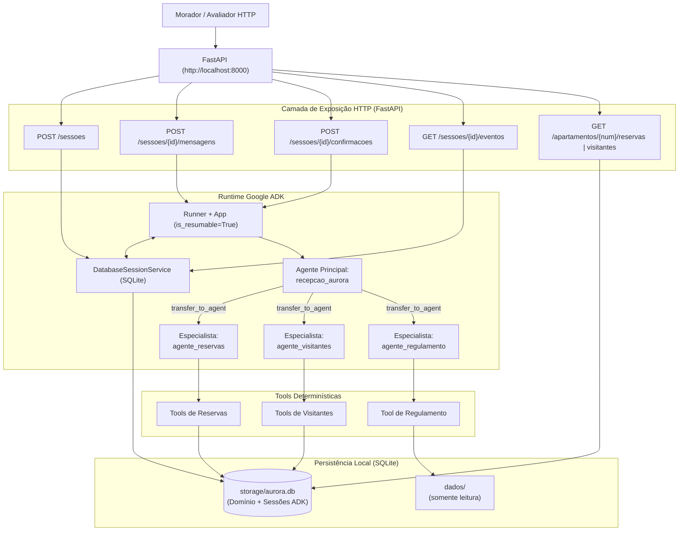
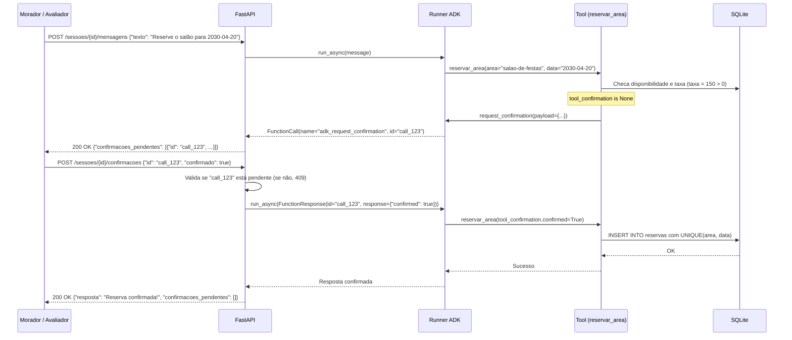
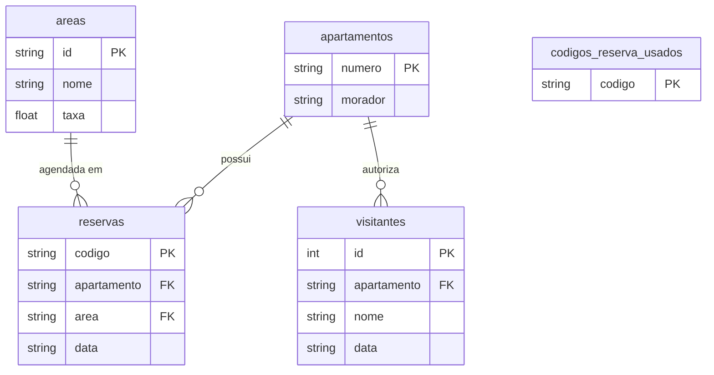

# FDD: Functional Design Document — Residencial Aurora

## 1. Diagrama de Arquitetura do Sistema (C4 / Container)



---

## 2. Diagrama Sequencial: Fluxo de Confirmação (Garantia 1)



---

## 3. Diagrama Sequencial: Concorrência Simultânea (Garantia 5)

```mermaid
sequenceDiagram
    participant Morador1 as Morador Apto 101 (S3)
    participant Morador2 as Morador Apto 201 (S4)
    participant API as FastAPI
    participant Tool as Tool (reservar_area)
    participant DB as SQLite (BEGIN IMMEDIATE)

    Note over Morador1, Morador2: Ambas sessões possuem confirmação pendente para salao-de-festas em 2030-05-11
    par Disparo Simultâneo (&)
        Morador1->>API: POST /sessoes/{S3}/confirmacoes {"id": "c1", "confirmado": true}
        Morador2->>API: POST /sessoes/{S4}/confirmacoes {"id": "c2", "confirmado": true}
    end

    API->>Tool: Executa aprovação S3
    Tool->>DB: BEGIN IMMEDIATE; INSERT INTO reservas
    DB-->>Tool: Inserção bem-sucedida! COMMIT

    API->>Tool: Executa aprovação S4
    Tool->>DB: BEGIN IMMEDIATE; INSERT INTO reservas
    DB-->>Tool: sqlite3.IntegrityError: UNIQUE constraint failed: reservas.area, reservas.data
    Tool-->>API: Captura erro -> {"status": "indisponivel", "mensagem": "Área acabou de ser reservada."}

    API-->>Morador1: 200 OK {"resposta": "Salão reservado com sucesso!"}
    API-->>Morador2: 200 OK {"resposta": "A área acabou de ser reservada por outro morador."}
```

---

## 4. Modelo Relacional de Dados (Diagrama ER)


