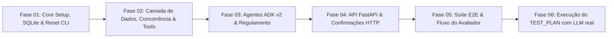

# Plano Mestre de Implementação (Greenfield Project Plan) — Residencial Aurora

## 1. Sumário Executivo
Este documento define o roteiro sequencial de implementação do assistente virtual do Residencial Aurora. O projeto é desenvolvido do zero (*greenfield*), partindo unicamente dos arquivos estáticos em [`dados/`](../dados), e dividido em seis fases atômicas orientadas a testes e validação contínua — as cinco fases de implementação do desafio, mais a Fase 06 de execução automatizada do `TEST_PLAN.md` contra a API real com LLM real.

---

## 2. Mapa de Fases e Dependências

---

## 3. Detalhamento das Fases

### Fase 01: Core Setup, SQLite & Reset CLI
- **Objetivo**: Configurar o ambiente com `uv`, estruturar o schema relacional no SQLite com suporte a WAL mode, criar o mecanismo de seed a partir de `dados/*.json` e a CLI de reset.
- **Entregáveis**:
  - `src/aurora/config.py`: Definições de caminhos e settings Pydantic.
  - `src/aurora/database.py`: Funções `get_db_connection()`, `init_schema()`, `seed_dados()` e `reset_database()`.
  - `src/aurora/cli.py`: Entrypoints `aurora-reset` e `aurora-run`.
  - `tests/test_database.py`: Teste de integridade do reset e seeds.
- **Documentação da Fase**: [`docs/phases/phase-01-core-setup/phase-01-core-setup.md`](phases/phase-01-core-setup/phase-01-core-setup.md)

### Fase 02: Camada de Dados, Concorrência & Tools Determinísticas
- **Objetivo**: Implementar as FunctionTools em Python com as garantias determinísticas em código (taxa > 0 com confirmação, taxa 0 direta, isolamento por apartamento via state, exclusividade física com `UNIQUE(area, data)` e `BEGIN IMMEDIATE`).
- **Entregáveis**:
  - `src/aurora/tools.py`:
    - `listar_areas_comuns`
    - `consultar_minhas_reservas`
    - `verificar_disponibilidade_area`
    - `reservar_area` (Garantia 1 & 5)
    - `cancelar_minha_reserva` (Garantia 2)
    - `listar_meus_visitantes`
    - `autorizar_visitante` (Garantia 1)
  - `tests/test_tools.py`: Testes das 5 garantias isoladas nas tools.
- **Documentação da Fase**: [`docs/phases/phase-02-storage-concurrency/phase-02-storage-concurrency.md`](phases/phase-02-storage-concurrency/phase-02-storage-concurrency.md)

### Fase 03: Agentes ADK v2 & Parser do Regulamento
- **Objetivo**: Construir o parser seletivo de `dados/regulamento.md` por capítulo e montar a topologia de agentes ADK (agente principal `recepcao_aurora` + subagents `agente_reservas`, `agente_visitantes`, `agente_regulamento`) com `ResumabilityConfig(is_resumable=True)`.
- **Entregáveis**:
  - `src/aurora/regulamento.py`: Parser granular `obter_capitulo(numero: int)`.
  - `src/aurora/agents.py`: Definição de `recepcao_aurora`, especialistas, App e Runner com `DatabaseSessionService`.
  - `tests/test_tools.py#L141-L150`: Teste de extração granular por capítulo (não há arquivo `test_regulamento.py` dedicado).
- **Documentação da Fase**: [`docs/phases/phase-03-adk-agents-tools/phase-03-adk-agents-tools.md`](phases/phase-03-adk-agents-tools/phase-03-adk-agents-tools.md)

### Fase 04: API FastAPI & Contrato HTTP
- **Objetivo**: Expor o assistente via FastAPI em `http://localhost:8000`, implementando exatamente o contrato do `DESAFIO.md` (`POST /sessoes`, `POST /mensagens`, `POST /confirmacoes`, `GET /eventos`, `GET /verificacao`), com validação estrita de status 409 para confirmações.
- **Entregáveis**:
  - `src/aurora/api.py`: Aplicação FastAPI, rotas, schemas Pydantic, serialização assíncrona por sessão.
  - `tests/test_api_contract.py`: Teste de todos os endpoints HTTP e status codes.
- **Documentação da Fase**: [`docs/phases/phase-04-fastapi-contract/phase-04-fastapi-contract.md`](phases/phase-04-fastapi-contract/phase-04-fastapi-contract.md)

### Fase 05: Suíte E2E & Fluxo do Avaliador
- **Objetivo**: Executar a auditoria completa e teste automatizado dos 15 passos sequenciais do fluxo do avaliador contra a API real, incluindo disputa simultânea de reserva com concorrência real e reinício de servidor.
- **Entregáveis**:
  - `tests/test_evaluator_flow.py`: Automação completa dos Passos 1 a 15.
  - `docs/TRACKER.md`: Rastreabilidade final 100% preenchida.
- **Documentação da Fase**: [`docs/phases/phase-05-e2e-evaluator-validation/phase-05-e2e-evaluator-validation.md`](phases/phase-05-e2e-evaluator-validation/phase-05-e2e-evaluator-validation.md)

### Fase 06: Execução Automatizada do TEST_PLAN.md
- **Objetivo**: Automatizar os 18 casos de teste (CT-01 a CT-18) de [`TEST_PLAN.md`](../TEST_PLAN.md) contra a API real com o LLM real (Gemini), incluindo reinício real do processo (CT-13, Garantia 3) e disputa concorrente real (CT-14) — complementar à Fase 05, que usa apenas mocks.
- **Entregáveis**:
  - `scripts/run_test_plan.sh`: script de automação ponta a ponta dos 18 CTs, com espera configurável entre chamadas (`REQUEST_DELAY_SECONDS`).
  - Bugs reais descobertos e corrigidos: formato do payload do ADK em `extrair_confirmacoes_pendentes`, resolução de área por nome legível em `reservar_area`/`verificar_disponibilidade_area`, e seleção de confirmação por `acao` em vez de índice `[0]` no próprio script.
  - Execução completa validada: 90/90 passos OK, 0 FALHOU (2026-10-20).
- **Status**: `clean` — ver [`docs/phases/phase-06-test-plan-execution/validation.md`](phases/phase-06-test-plan-execution/validation.md).
- **Documentação da Fase**: [`docs/phases/phase-06-test-plan-execution/phase-06-test-plan-execution.md`](phases/phase-06-test-plan-execution/phase-06-test-plan-execution.md)
